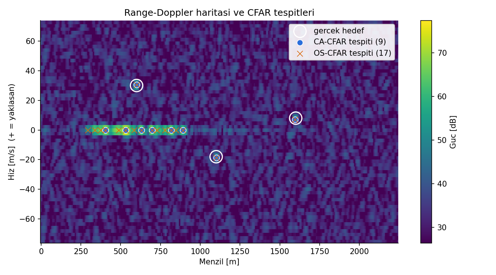
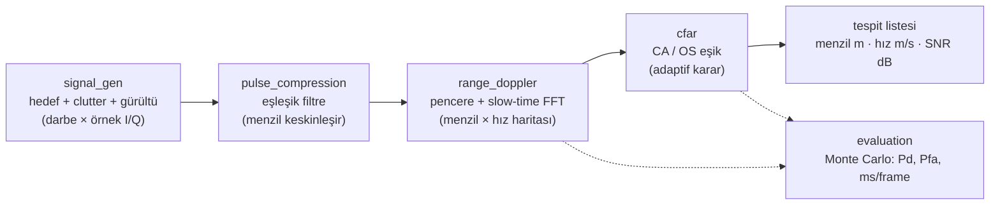
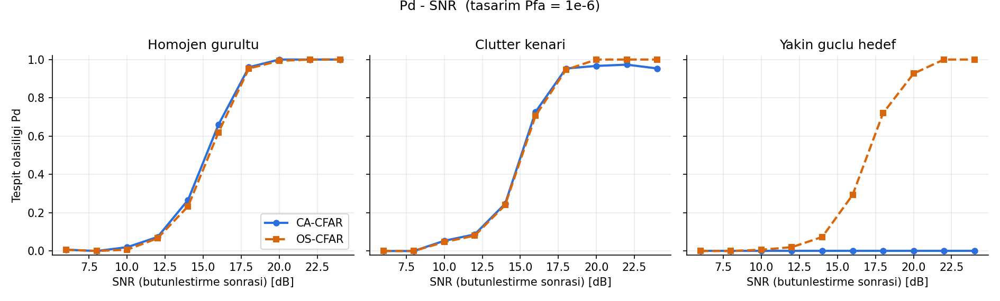
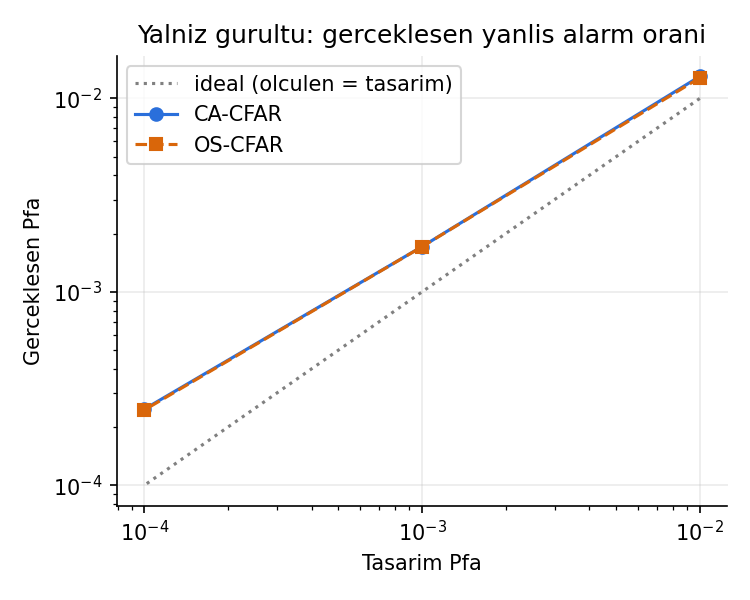
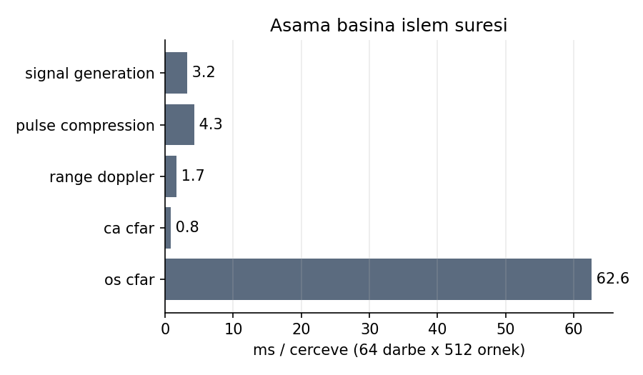

# cfar-radar-pipeline

C++17 ile sıfırdan yazılmış bir **radar sinyal işleme hattı**: simüle I/Q verisi üzerinde **darbe sıkıştırma**, **range-Doppler FFT** ve **CA-/OS-CFAR hedef tespiti**; Monte Carlo ile **Pd / Pfa** ve işlem süresi ölçümü. Harici kütüphane yok — FFT dahil her algoritma bu depoda.



*Üç hareketli hedef ve 300–900 m arasında sıfır Doppler clutter şeridi. Beyaz daireler gerçek hedefler, mavi daireler CA-CFAR, turuncu çarpılar OS-CFAR tespitleri.*

## Neler var?

| Modül | İş | Dosya |
|---|---|---|
| Sinyal modeli | LFM chirp, hareketli hedefler (Doppler fazı), karmaşık Gauss gürültü, clutter | `src/signal_gen.*` |
| FFT | Kendi yazdığım iteratif radix-2 FFT/IFFT, referans DFT, `fftshift` | `src/fft.*` |
| Darbe sıkıştırma | FFT tabanlı eşleşik filtre, Hamming yan lob ağırlığı | `src/pulse_compression.*` |
| Range-Doppler | Slow-time FFT, Hann/Hamming pencere, menzil/hız eksenleri, CSV çıktısı | `src/range_doppler.*` |
| CFAR | 2B CA-CFAR (integral görüntü ile O(1)) ve OS-CFAR (`nth_element`) | `src/cfar.*` |
| Değerlendirme | Monte Carlo Pd / Pfa, aşama başına süre | `src/evaluation.*` |

## Mimari



## Derleme ve çalıştırma

Gereksinimler: C++17 derleyici (GCC/Clang/MinGW), CMake ≥ 3.16. Grafikler için Python 3 + `numpy`, `matplotlib`.

```bash
cmake -S . -B build
cmake --build build
ctest --test-dir build --output-on-failure      # 5 test
./build/radar_demo                              # demo + Monte Carlo (birkaç dakika)
./build/radar_demo --no-mc                      # yalnızca demo (saniyeler)
./build/radar_demo --trials 300                 # daha hassas Pd eğrileri

python scripts/plot.py                          # output/*.csv -> docs/images/*.png
```

(Klasik biçim de çalışır: `mkdir build && cd build && cmake .. && make && ./radar_demo`.)

`radar_demo` şunları yazdırır: radar tasarım büyüklükleri, gerçek hedefler, CA/OS tespit listeleri, süre tablosu, Pd–SNR tabloları ve gerçekleşen Pfa. CSV çıktıları `output/` klasörüne gider.

## Radar parametreleri

| Parametre | Değer | Türetilen | Değer |
|---|---|---|---|
| Taşıyıcı | 10 GHz (X-band) | Dalga boyu λ = c/fc | 3 cm |
| Bant genişliği B | 10 MHz | Menzil çözünürlüğü c/(2B) | 14.99 m |
| Örnekleme fs | 20 MHz | Menzil hücresi c/(2fs) | 7.49 m |
| Darbe genişliği | 10 µs (200 örnek) | Hız çözünürlüğü λ·PRF/(2N) | 2.34 m/s |
| PRF / darbe sayısı | 10 kHz / 64 | Belirsiz hız ±λ·PRF/4 | ±75 m/s |

## Kullanılan denklemler

* **LFM chirp:** s(t) = exp(jπk(t − Tp/2)²), k = B/Tp
* **Gecikme ve Doppler:** τ = 2R/c; fd = 2v/λ; darbeler arası faz adımı = 2π·fd/PRF
* **Eşleşik filtre:** y[n] = Σ x[n+m]·s*[m] ⇔ Y[k] = X[k]·S*[k] (FFT → çarp → IFFT). Kazanç L = B·Tp, çözünürlük c/2B
* **Doppler ekseni:** fd = (k − N/2)·PRF/N, v = fd·λ/2
* **CA-CFAR:** eşik = α·ortalama(eğitim hücreleri), α = N·(Pfa^(−1/N) − 1)
* **OS-CFAR:** eşik = T·(k. sıralı istatistik); Pfa = Π_{i=0}^{k−1} (N−i)/(N−i+T) denkleminden T sayısal çözülür
* **Bütünleştirme sonrası SNR** = A²·L·N/σ² (sıkıştırma ≈ 23 dB + darbe toplama ≈ 18 dB)

## Sonuçlar

### Pd – SNR (tasarım Pfa = 10⁻⁶, 150 deneme/nokta)



| Senaryo | Pd = 0.5 SNR | Pd ≥ 0.95 SNR (CA / OS) |
|---|---|---|
| Homojen gürültü | ≈ 15.5 dB | 18 dB / 18 dB |
| Clutter kenarı | ≈ 15.5 dB | ≈ 18 dB / ≈ 18 dB (CA yüksek SNR'da 0.95–0.97'de kalır, OS 20 dB'den itibaren 1.0) |
| Yakın güçlü hedef (+15 dB, eğitim penceresinde) | CA: hiçbir SNR'da (Pd ≈ 0) · OS: ≈ 17 dB | CA: yok / OS: 22 dB |

* **Homojen gürültüde CA ≈ OS.** Pd = 0.5 noktası teorik bağımsız-hücre değerinden birkaç dB sağda; fark Hann penceresi (≈ 1.8 dB), Hamming ağırlıklı filtre (≈ 1.3 dB), scalloping ve CFAR kayıplarıdır.
* **Eğitim penceresinde güçlü komşu varsa CA-CFAR hedefi kaçırır** (maskeleme): ortalama şişer, eşik hedefin üstüne çıkar. OS-CFAR k. sıralı istatistiği kullandığı için bundan etkilenmez.

### Gerçekleşen Pfa (yalnızca gürültü)



| Tasarım Pfa | CA-CFAR | OS-CFAR |
|---|---|---|
| 10⁻² | 1.30·10⁻² | 1.28·10⁻² |
| 10⁻³ | 1.71·10⁻³ | 1.71·10⁻³ |
| 10⁻⁴ | 2.48·10⁻⁴ | 2.45·10⁻⁴ |

Ölçülen Pfa tasarımdan **1.3–2.5 kat yüksek**. Sebep: eşik formülleri bağımsız üstel hücreleri varsayar; gerçekte fs = 2B ile sıkıştırılmış gürültü komşu menzil hücrelerinde, Hann penceresi komşu Doppler hücrelerinde ilintilidir. Bu sapmayı görmek ve açıklamak projenin amaçlarındandı.

### Performans (64 darbe × 512 örnek, tek çekirdek, `-O3`)



| Aşama | ms / çerçeve |
|---|---|
| Darbe sıkıştırma | 4.3 |
| Range-Doppler | 1.7 |
| CA-CFAR | 0.8 |
| OS-CFAR | 62.6 |
| **Hat (sıkıştırma + RD + CA-CFAR)** | **≈ 6.7** |
| Hat (OS-CFAR ile) | ≈ 68.5 |

CA-CFAR integral görüntü sayesinde hücre başına O(1); OS-CFAR her hücrede 138 elemanlı kısmi sıralama yaptığı için ≈ 80 kat yavaş. (Süreler makineye ve anlık yüke bağlıdır; oranlar daha anlamlıdır.)

## Testler

Dış bağımlılık yok (`tests/test_util.h`); CTest ile 5 test:

* `test_signal_gen` — çözünürlük hesapları, chirp genliği, yankı süresi, Doppler faz adımı, gürültü gücü
* `test_fft` — bilinen sinüs, FFT = naif DFT, ifft(fft(x)) = x, Parseval
* `test_pulse_compression` — tepe doğru menzil hücresinde, kesirli gecikme, gürültüde tespit, iki hedefin ayrışması, yan lob bastırma
* `test_range_doppler` — bilinen menzil/hızdaki hedef beklenen hücrede, pencere etkisi
* `test_cfar` — eşik çarpanı formülleri, gürültüde gerçekleşen Pfa, CA maskeleme / OS dayanıklılığı, uçtan uca tespit

## Öğrenilen dersler

* **Yan lob tabanı:** Çok güçlü clutter (CNR ≈ 50 dB) Hamming ağırlığıyla bile (−44 dB) sıfır Doppler satırını gürültünün ≈ 15 dB üstüne çıkardı ve zayıf hedefi gizledi. Demo clutter'ı gerçekçi seviyeye çekildi.
* **CFAR durağan clutter'ı bastırmaz:** Sıfır Doppler şeridindeki güçlü hücreler hedef gibi görünür; OS-CFAR'da eğitim hücrelerinin >%25'i clutter olunca (75. yüzdelik) daha çok sahte tespit çıkar. Çözüm MTI / Doppler çentik filtresi.
* **Ölçülen SNR ≠ girilen SNR:** pencere, ağırlık ve scalloping kayıpları birkaç dB tutar.

Ayrıntılı anlatım, okuma sırası ve 10 mülakat sorusu: [`docs/LEARNING_NOTES.md`](docs/LEARNING_NOTES.md).

## Kısıtlar ve gelecek işler

* Basitleştirilmiş fiziksel model: stop-and-hop, menzil göçü yok, tek kanal, yayılım kayıpları yok.
* Dairesel korelasyon nedeniyle pencerenin son ~200 örneğine düşen hedefler kesilir; değerlendirme bu bölgeyi kullanmaz.
* Alt-hücre interpolasyonu yok; kestirimler hücre ızgarasına bağlı.
* Gelecek: MTI/clutter bastırma, Kalman filtresiyle takip, SIMD/OpenMP ile OS-CFAR hızlandırma, FFTW ile karşılaştırma, ilinti için kalibre edilmiş eşik çarpanı, tespitlerin mesh ağı üzerinden FEC korumalı iletimi.

## Depo yapısı

```
├── CMakeLists.txt
├── src/        radar_params.h, matrix.h, signal_gen, fft, pulse_compression,
│               range_doppler, cfar, evaluation, main.cpp
├── tests/      5 test + test_util.h
├── scripts/    plot.py (grafikler), make_report.py (PDF rapor)
└── docs/       LEARNING_NOTES.md, images/
```
